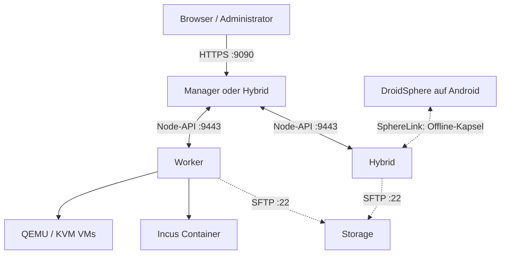

# ◉ LinuxSphere VE

### Eine Virtualisierungsplattform für lokale Kontrolle, modulare Infrastruktur und vernetzte Knoten.

**Virtuelle Maschinen · Container · Knoten · Storage · Backups · Browser-CLI**

**[English](README.md) · [Deutsch](README.de.md) · [Installation](docs/de/INSTALLATION.md) · [Architektur](docs/de/ARCHITEKTUR.md) · [Roadmap](docs/ROADMAP.md)**

---

## Über das Projekt

**LinuxSphere VE** ist eine eigenständig installierbare, Debian-basierte Virtualisierungsumgebung für **x86-64-PCs und Server**. Im Browser verwaltest du virtuelle Maschinen, Container, Ressourcen, Datenträger, Backups und vernetzte Knoten. Bereits bei der Installation wählst du zwischen **Hybrid, Manager, Worker und Storage**.

Zum gemeinsamen Projektökosystem gehört **DroidSphere**: eine **separate Android-Anwendung** zur lokalen Virtualisierung ausgewählter Gastbetriebssysteme auf einem Mobilgerät. Die **SphereLink**-Schnittstelle verknüpft beide Systeme über eine kontrollierte Kopplung und verschlüsselte Offline-Transfers.

> [!IMPORTANT]
> **Entwicklungsversion – 0.2 International.** ISO-Inhalt und Projektquelltexte wurden geprüft. Eine vollständige Abnahme auf unterschiedlichen physischen Servern, ein unabhängiger Sicherheitsaudit oder eine Freigabe für ausfallkritische Produktionssysteme ist damit nicht belegt. Details im [Projektstatus](docs/PROJECT_STATUS.md).

## Funktionen im aktuellen Stand

| Bereich | Umfang von LinuxSphere VE 0.2 |
| --- | --- |
| **Virtuelle Maschinen** | x86-64-Gäste über QEMU/libvirt, optional KVM, BIOS/UEFI, QCOW2, eigene ISO-Medien |
| **Container** | Incus-Verwaltung und ein mitgeliefertes minimales Offline-Testimage |
| **Knotenrollen** | Hybrid, Manager, Worker, Storage; Knotenbindung und Übersicht |
| **Web-Dashboard** | Cockpit-basierte Verwaltung für Gäste, Systemwerte, Ressourcen und Knoten |
| **Integrierte CLI** | Interaktive Host-Shell, `virsh`, `incus`, Host-Konfiguration und separat authentifizierte Node-Terminals |
| **Mehrsprachigkeit** | Englisch, Deutsch, Französisch, Spanisch; Hostsprache und Browseroberfläche getrennt wählbar; eigene Sprachpakete |
| **Backups** | Verschlüsselte, deduplizierte Restic-Sicherungen, Wiederherstellung und SFTP-Synchronisation |
| **SphereFusion** | Verteilung unabhängiger Jobs auf Worker-Container, **kein** gemeinsamer RAM einer einzelnen VM |
| **SphereLink** | Kopplung mit DroidSphere VE 2.0 und verschlüsselter Offline-Import unterstützter x86-Gäste |
| **SafeChange** | Letzte unterstützte vCPU-/RAM-Zuweisungsänderung zurücksetzen |

## Vier Rollen

| Rolle | Aufgabe |
| --- | --- |
| **Hybrid** | Verwaltung und Ausführung lokaler VMs und Container auf einem Host |
| **Manager** | Steuerungs- und Verwaltungsinstanz für verbundene Knoten |
| **Worker** | Zusätzliche Rechenkapazität für eigene VMs, Container und Aufträge |
| **Storage** | Getrenntes Ziel für Backups und sicheren SFTP-Transfer |

## Erster Start

1. Die Datei **`LinuxSphere-VE-0.2-International-amd64.iso`** nach Veröffentlichung aus **GitHub Releases** herunterladen und die SHA-256-Prüfsumme abgleichen.
2. Auf einer Testmaschine per BIOS oder UEFI starten. Für einen einzelnen Server **Install Hybrid** wählen.
3. Installationssprache, Tastatur, Benutzerkonto und Ziellaufwerk festlegen. **Die Installation kann den gewählten Datenträger überschreiben.**
4. Nach dem Neustart **`https://SERVER-IP:9090/linuxsphere`** im vertrauenswürdigen Netzwerk öffnen.
5. Mit dem bei der Installation eingerichteten Host-Benutzer anmelden. Administrative Rechte in Cockpit bei Bedarf aktivieren.
6. Eine Test-VM oder einen Incus-Container anlegen und Dashboard, CLI, Sprachoptionen, Backups und Knotenverwaltung erkunden.

**Planungswert für erste Tests:** 2 logische CPUs, 4 GiB RAM und 20 GiB Systemspeicher zuzüglich Speicherkapazität für Gäste und Backups. Intel VT-x bzw. AMD-V wird empfohlen.

Vollständiger Leitfaden: [Installation auf Deutsch](docs/de/INSTALLATION.md).

## Architektur im Überblick

Die Gäste verwenden zunächst **CPU und RAM des eigenen Hosts**. SphereFusion verteilt explizite Einzelaufträge. Transparentes VM-RAM-Pooling über das Netzwerk, allgemeine Live-Migration und vollständig automatisches Cluster-Failover sind **nicht** nachgewiesen.

## LinuxSphere und DroidSphere

**LinuxSphere** ist das x86-64-Serverbetriebssystem mit Knotenrollen, VMs, Containern und Backup-Diensten. **DroidSphere** ist eine eigene Android-Anwendung mit lokaler QEMU-Laufzeit und LAN-Browserzugriff. Über SphereLink können unterstützte, **ausgeschaltete** DroidSphere-x86-PC-Gäste als verschlüsselte `.dscap`-Dateien an einen LinuxSphere-Worker oder -Hybrid übertragen und dort importiert werden. Das ist keine Live-Migration und keine automatische Übernahme beliebiger ARM64-Android-Gäste.

[Technische Details zur Kopplung](docs/de/DROIDSPHERE.md).

## Technik

**Debian 13 (Trixie)** · Linux-Kernel · systemd · **QEMU / libvirt / KVM** · **Incus** · **Cockpit** · Python-Dienste · JavaScript / xterm.js · **Restic** · **SSH/SFTP** · `dsctl`

Auf dem Installationsmedium liegen Quelltexte unter `linuxsphere/system/`. Dieses GitHub-Paket enthält einen aus der v0.2-ISO entnommenen **Quellcode-Snapshot** – jedoch **keine vollständig geprüfte, reproduzierbare ISO-Build-Pipeline**.

## Weitere Informationen

- [Architektur](docs/de/ARCHITEKTUR.md) · [FAQ](docs/de/FAQ.md) · [Roadmap](docs/ROADMAP.md)
- [Projektstatus und bekannte Grenzen](docs/PROJECT_STATUS.md) · [Release Notes 0.2](docs/RELEASE_NOTES_v0.2.md)
- [Sicherheitsmodell](docs/SECURITY_MODEL.md) · [Lizenzen / Abhängigkeiten](docs/LICENSING.md)
- [Mitarbeit](CONTRIBUTING.md) · [Sicherheitsmeldungen](SECURITY.md)

**Lizenzhinweis:** Das Installationsmedium enthält Drittsoftware mit eigenen Lizenzen. Für eigenständige LinuxSphere-Komponenten muss vor einer vollständigen Open-Source-Freigabe eine klare, geprüfte Lizenzentscheidung getroffen werden. Eine mögliche MIT-Lizenz liegt nur als **Vorlage**, nicht als aktive `LICENSE`-Datei vor.

---

**LinuxSphere VE** — Lokale Infrastruktur. Vernetzte Möglichkeiten. Klare technische Grenzen.

