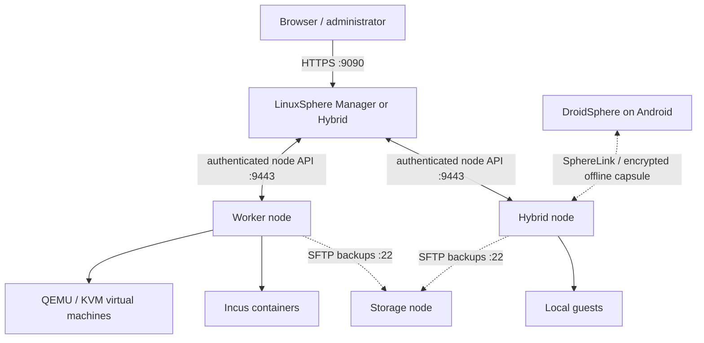

# ◉ LinuxSphere VE

### A server virtualization platform built for local control, modular infrastructure and connected nodes.

**Virtual machines · Containers · Nodes · Storage · Backups · Browser CLI**

**[English](README.md) · [Deutsch](README.de.md) · [Installation](docs/en/INSTALLATION.md) · [Architecture](docs/en/ARCHITECTURE.md) · [Roadmap](docs/ROADMAP.md)**

---

## Introduction

**LinuxSphere VE** is a self-hosted, Debian-based virtualization environment for **x86-64 PCs and servers**. It provides a browser-based administration interface for virtual machines, containers, hardware resources, storage, encrypted backups and multi-node coordination. During setup, each machine assumes one of four complementary roles: **Hybrid, Manager, Worker or Storage**.

The wider Sphere ecosystem also includes **DroidSphere**, a separate Android application that runs and manages selected virtual machines on the mobile device itself. **SphereLink** connects the two platforms through controlled pairing and encrypted offline guest transfers.

> [!IMPORTANT]
> **Development preview — v0.2 International.** The installation image and component sources have been inspected, but this repository does **not** claim independent hardware certification, a completed security audit, production-grade high availability, or tested compatibility with all devices. See [Project status](docs/PROJECT_STATUS.md).

## What you can do

| Capability | LinuxSphere VE 0.2 scope |
| --- | --- |
| **Virtual machines** | Create and manage local x86-64 guests using QEMU/libvirt; KVM acceleration when the host permits it; BIOS/UEFI, QCOW2 and guest ISO uploads |
| **Containers** | Manage Incus containers; an offline-friendly `sphere-mini` test image is included in the installer |
| **Node management** | Install distinct **Manager**, **Worker**, **Hybrid** and **Storage** nodes; pairing and inventory through authenticated node communication |
| **Web management** | Cockpit-integrated LinuxSphere dashboard with status, guest operations, node management and resource controls |
| **Integrated CLI** | Open an interactive host shell, manage VMs with `virsh`, containers with `incus`, and reach authorized node terminals with separate host credentials |
| **Internationalization** | English, German, French and Spanish UI packs; browser language and system locale controls; custom translation packs |
| **Backups** | Restic-based encrypted, deduplicated backups and offline restore workflows; SFTP synchronization to compatible nodes |
| **SphereFusion** | Send independent, explicitly defined jobs to remote worker containers — **not** transparent shared RAM or CPU for one VM |
| **SphereLink** | Pair with DroidSphere VE 2.0; obtain encrypted `.dscap` capsules and import compatible powered-off x86 PC guests |
| **SafeChange** | Undo the last supported CPU/RAM allocation change for managed guests |

For limitations and verification depth, read [Project status](docs/PROJECT_STATUS.md).

## System model

**Important:** Each guest normally uses the CPU and RAM of its own host. SphereFusion distributes **separate jobs**, not one VM's memory address space across devices. High-availability failover and general live migration are not established features of this preview.

## Four installation roles

| Role | Purpose | Typical use |
| --- | --- | --- |
| **Hybrid** | Local guest execution and central administration | First installation, home lab, single host |
| **Manager** | Node overview, pairing and job coordination | Dedicated control plane |
| **Worker** | Guest execution and distributed tasks | Additional compute host |
| **Storage** | Backup destination and SFTP storage services | Separate recovery node |

## Quick start

1. Download **`LinuxSphere-VE-0.2-International-amd64.iso`** from the repository's **Releases** section once a release is published; verify its SHA-256 digest.
2. Boot a test PC or virtual machine in **BIOS or UEFI** mode. Select **Install Hybrid** for a first standalone deployment.
3. Choose your installation language, keyboard layout and target disk. **Installation can overwrite the selected disk.**
4. Reboot into the new installation and open **`https://SERVER-IP:9090/linuxsphere`** on a trusted local network.
5. Sign in with the host account created during installation. Enable administrative access in the Cockpit interface only when needed.
6. Create a small VM or container, inspect resources, and explore the **CLI**, **Nodes**, **SphereFusion**, **Backups** and **Language** sections.

**Initial test sizing:** plan for 2 logical CPUs, 4 GiB RAM and 20 GiB of system storage **plus guest capacity**. Hardware virtualization support (Intel VT-x / AMD-V) is recommended. An isolated lab or test VM is recommended for the first trial.

Full steps: [English installation guide](docs/en/INSTALLATION.md) · [Deutsche Installationsanleitung](docs/de/INSTALLATION.md).

## LinuxSphere × DroidSphere

| LinuxSphere | DroidSphere |
| --- | --- |
| Installable Linux server environment | Separate Android application |
| Local x86-64 VMs and Incus containers | Local Android-hosted QEMU guest execution |
| Manager / Worker / Hybrid / Storage roles | Mobile guest management and LAN browser access |
| Restic backups and node coordination | Encrypted VM export capsules (`.dscap`) |
| Imports supported powered-off x86 PC capsules | Exports supported powered-off guests |

**SphereLink** uses an explicitly authorized DroidSphere HTTPS connection, certificate fingerprint verification and encrypted offline transfer. It is **not** live migration, automatic ARM-to-x86 conversion or transparent device resource pooling.

[Learn more about DroidSphere integration](docs/en/DROIDSPHERE.md).

## Interfaces and stack

- **Base:** Debian GNU/Linux 13 (Trixie), Linux kernel, systemd
- **VM engine:** QEMU, libvirt, optional KVM acceleration, QCOW2
- **Containers:** Incus
- **Control plane:** LinuxSphere Python host services, authenticated HTTPS node API
- **Frontend:** Cockpit integration, HTML/CSS/JavaScript, xterm.js
- **Backup:** Restic; SFTP-based copy/synchronization
- **Administration:** Web UI, SSH, `dsctl`, `virsh`, `incus`

The shipped installer includes localized guides and project system sources under `linuxsphere/system/`. This repository includes a source snapshot taken from the v0.2 installer, **not** a fully validated reproducible ISO build pipeline. See [source provenance](src/README.md).

## Documentation

| Topic | English | Deutsch |
| --- | --- | --- |
| Installation | [Install](docs/en/INSTALLATION.md) | [Installation](docs/de/INSTALLATION.md) |
| Architecture | [Architecture](docs/en/ARCHITECTURE.md) | [Architektur](docs/de/ARCHITEKTUR.md) |
| DroidSphere interoperability | [SphereLink](docs/en/DROIDSPHERE.md) | [SphereLink](docs/de/DROIDSPHERE.md) |
| FAQ | [FAQ](docs/en/FAQ.md) | [FAQ](docs/de/FAQ.md) |
| Release and verification | [Release notes](docs/RELEASE_NOTES_v0.2.md) | [Project status](docs/PROJECT_STATUS.md) |
| Planning and trust | [Roadmap](docs/ROADMAP.md) | [Security model](docs/SECURITY_MODEL.md) |

## Contributing and security

The project welcomes reproducible issue reports, translations, documentation fixes and carefully scoped patches. Read [CONTRIBUTING.md](CONTRIBUTING.md), [CODE_OF_CONDUCT.md](CODE_OF_CONDUCT.md) and [SECURITY.md](SECURITY.md). Do not post passwords, pairing codes, private certificates or vulnerability exploitation details in public issues.

**Licensing:** The installer contains upstream open-source software with separate licenses. The original LinuxSphere source must receive an explicit, reviewed license before the repository can be described as fully open-source. See [Licensing and notices](docs/LICENSING.md). This publication kit includes a **non-active** MIT license template for consideration, not an automatic license grant.

---

**LinuxSphere VE** — Local infrastructure. Connected capabilities. Transparent boundaries.

*Built independently as a developing virtualization and infrastructure management project.*

