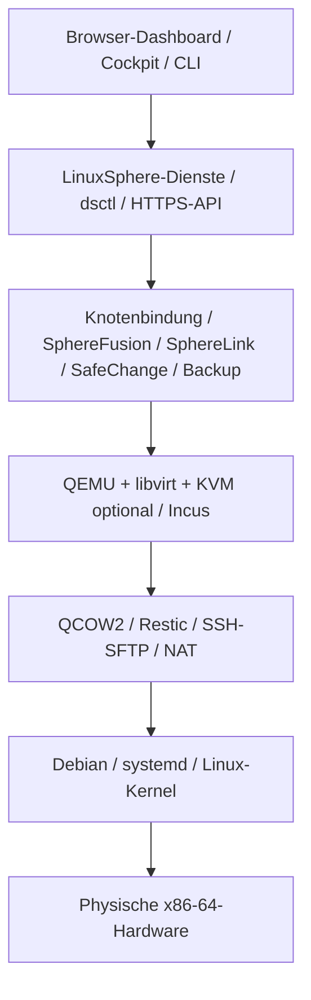
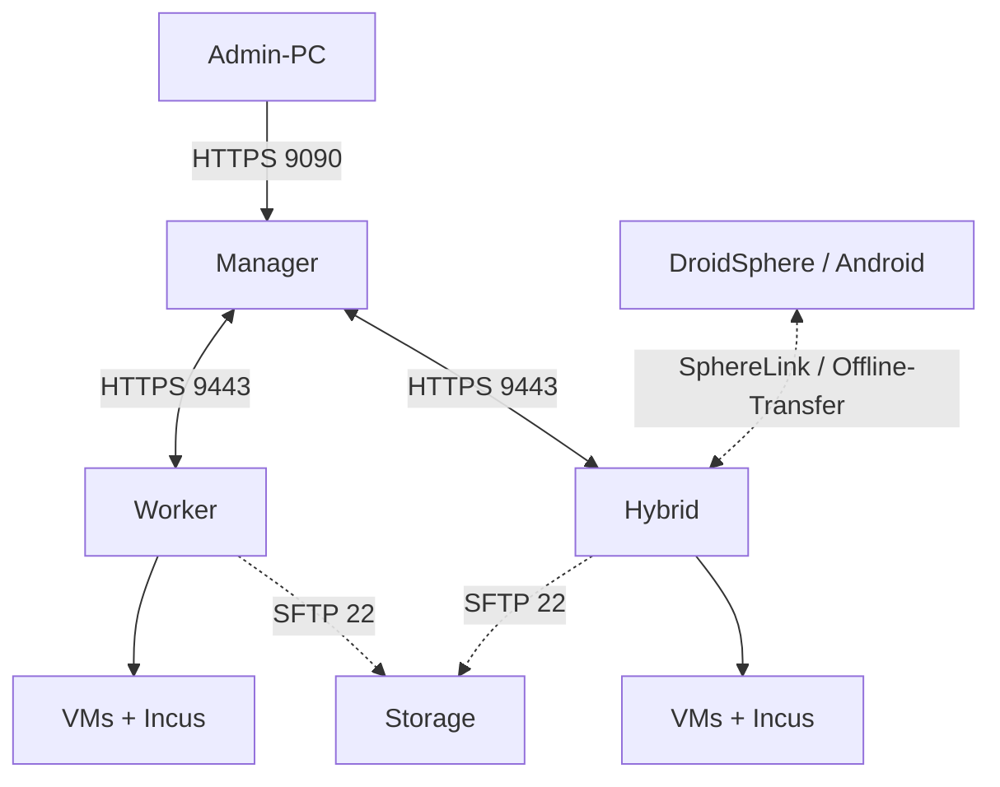

# LinuxSphere VE — Technische Architektur

**Stand:** 0.2 International, Debian 13 (Trixie), x86-64. Die Beschreibung stützt sich auf Komponenten der untersuchten ISO, nicht auf eine externe Sicherheits- oder Performancezertifizierung.

## Schichtenmodell

Das Web-Dashboard ist eine **Administrationsoberfläche**, kein eigenständiger lokaler Desktop. Die Host-Hardware stellt CPU, RAM, Datenträger und Netzwerkschnittstellen bereit. KVM ermöglicht bei passender Hardware und Freigabe beschleunigte Virtualisierung; bei fehlendem Zugriff muss mit eingeschränkter QEMU-Emulationsleistung gerechnet werden.

## Kerndienste

| Ebene | Inhalt |
| --- | --- |
| Betriebssystem | Debian GNU/Linux 13, Linux-Kernel, systemd |
| VM-Laufzeit | QEMU, libvirt, optional KVM, BIOS/UEFI, QCOW2 |
| Container | Incus und eigene Instanzen/Netze |
| Management | Cockpit (HTTPS 9090), LinuxSphere Python-Dienste, `dsctl` |
| Knotenkommunikation | TLS-geschützte API auf TCP 9443 und befristete Knotenbindung |
| Recovery | Verschlüsselte Restic-Repositories, SSH/SFTP für Kopien |
| CLI | Host-Shell über Browser, `virsh`, `incus`, `nmtui`, SSH |

## Netzplan

**Netzwerkgrenzen:** Managementports nur im LAN/VPN, Gastnetz von der Hostverwaltung trennen, TLS-Fingerprints und SSH-Hostschlüssel verifizieren. VNC-Konsole ist am Host-Loopback vorgesehen, nicht als offener öffentlicher Port.

## Rollen und verteilte Aufgaben

- **Manager:** Verwaltung, Inventarisierung, Einladungen und Koordination.
- **Worker:** Lokale physische Ressourcen und eigene VM-/Containerprozesse.
- **Hybrid:** Verwaltung sowie lokale Gastlaufzeit.
- **Storage:** Getrenntes Backupziel mit SSH/SFTP.

**SphereFusion** verteilt unabhängige, autorisierte Aufgaben auf vorbereitete Worker-Container. CPU und RAM einer laufenden Desktop-VM verbleiben auf ihrem eigenen Host. Transparentes gemeinsames RAM, universelles Live-Migration-Framework und hochverfügbares automatisches Failover sind nicht Teil des nachgewiesenen Funktionsumfangs.

## DroidSphere-Anbindung

SphereLink erlaubt einen kontrollierten HTTPS-Austausch verschlüsselter `.dscap`-Kapseln. Unterstützte **ausgeschaltete x86-PC-Gäste** aus DroidSphere können als neue LinuxSphere-VMs importiert werden. Ein ARM64-Android-Gast wird dadurch nicht automatisch in einen x86-Gast umgewandelt.

Weiter: [DroidSphere-Kopplung](DROIDSPHERE.md) · [Sicherheitsmodell](../SECURITY_MODEL.md).
