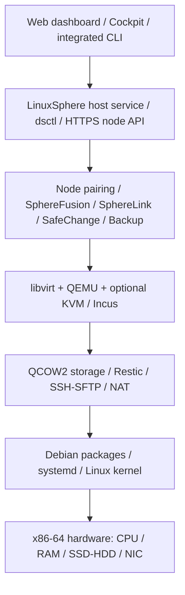
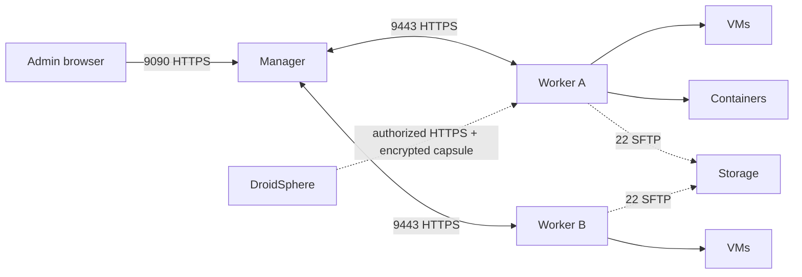

# LinuxSphere VE — Technical architecture

**Release baseline:** 0.2 International / Debian 13 (Trixie) / x86-64. This document describes components represented in the inspected installation image; it is not an independent security or performance certification.

## System layers

The browser UI is an administrative web console, not a separate traditional local GUI desktop. LinuxSphere uses Debian's kernel and driver model. A KVM-capable host can accelerate compatible guests; the existence of a CPU virtualization feature alone does not guarantee that KVM is accessible to every nested or physical setup.

## Services and responsibilities

| Component | Responsibility |
| --- | --- |
| Debian GNU/Linux 13 | Base operating system, package management, host drivers and system services |
| Cockpit at HTTPS 9090 | Host sign-in, management UI, integrated console |
| LinuxSphere Python services | Guest operations, control plane, status, node enrollment, backup and transfer orchestration |
| LinuxSphere HTTPS API at TCP 9443 | Authenticated management operations and explicit distributed jobs |
| QEMU/libvirt | VM lifecycle, guest disks, virtual networking and display |
| KVM (when available) | Hardware-assisted CPU virtualization |
| Incus | Container instance lifecycle and configuration |
| Restic + SSH/SFTP | Encrypted backup repositories and off-host copy |
| `dsctl` / `virsh` / `incus` | Administrator command-line workflows |
| xterm.js in Cockpit | Browser-rendered interactive PTY terminal |

## Network topology

The ports are initial project defaults, not an invitation to forward them to the public internet. VM NAT and local loopback-bound graphical consoles must remain separate from the management network. SSH host keys and certificate fingerprints must be validated.

## Node roles

**Hybrid** combines local compute with management. **Manager** coordinates and inventories remote nodes. **Worker** owns its local guest processes and physical RAM. **Storage** provides an off-host backup destination; it is not a shared-memory pool or an automatic live block-storage layer.

## SphereFusion execution model

1. A caller supplies **independent program/argument jobs** and valid authorization.
2. The manager selects configured workers with prepared, unprivileged Incus execution containers.
3. Jobs execute remotely with per-job status, exit codes and output returned to the manager.
4. A desktop VM remains hosted by one machine; ordinary programs inside it are not transparently distributed.

**Not included:** coherent distributed guest RAM, cross-device virtual NUMA, hardware device pooling for one running guest, production HA quorum/fencing or general live migration.

## SphereLink transfer model

1. An Android user explicitly enables DroidSphere's local HTTPS service and authorizes pairing.
2. LinuxSphere verifies the server fingerprint and pairing data.
3. A **stopped** DroidSphere PC guest is exported as an authenticated, encrypted `.dscap` capsule.
4. LinuxSphere validates capsule contents and QCOW2 integrity, then imports a compatible **x86 BIOS/UEFI** guest as a **new, stopped** instance.
5. The system does not automatically convert arbitrary ARM64 Android guests into x86 PC guests.

See [DroidSphere integration](DROIDSPHERE.md) and [security boundaries](../SECURITY_MODEL.md).

## Source layout and provenance

`src/linuxsphere/system/` is a snapshot of the v0.2 image's project tree. ISO source locations are `linuxsphere/system/` on the media and `/usr/lib/linuxsphere/` after installation. The ISO also carries Debian packages and a minimal container image. This GitHub publishing package is **not** an all-dependencies-included or independently reproducible installer build system. Technical verification details are recorded in [PROJECT_STATUS](../PROJECT_STATUS.md).
