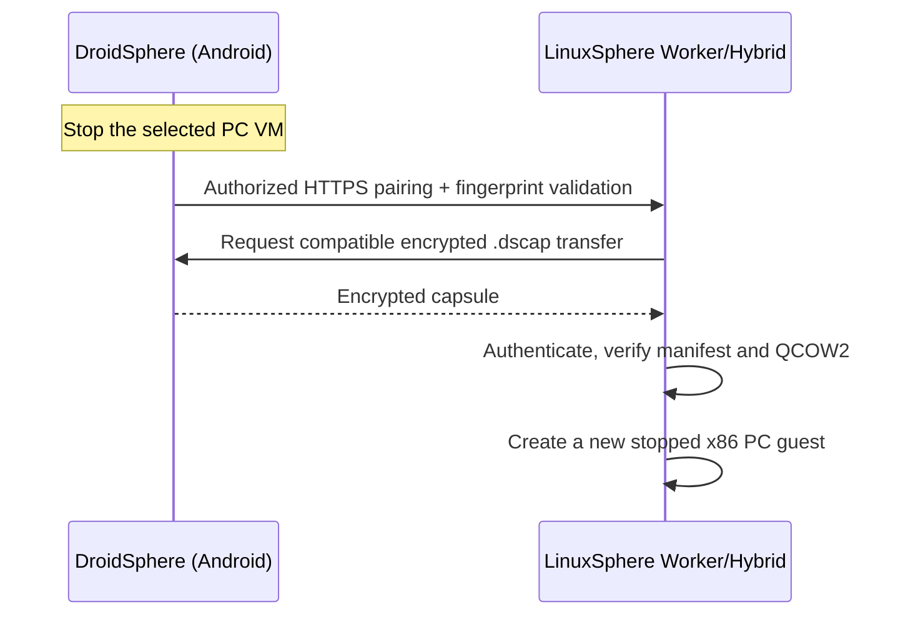

# DroidSphere × LinuxSphere — interoperability

**Two products, separate runtimes, complementary workflows.**

| | LinuxSphere VE | DroidSphere VE |
| --- | --- | --- |
| Host | Debian-based x86-64 PC/server | Android smartphone/tablet |
| Execution | Local QEMU/libvirt VMs and Incus containers | Local QEMU virtual machines inside the Android app |
| Administration | Cockpit, `dsctl`, SSH and node API | Android UI, authorized HTTPS/browser and SSH access |
| Portable transfer | Imports supported encrypted PC guest capsules | Exports supported powered-off guest capsules |
| Release basis used here | 0.2 International | 2.0 |

## SphereLink — practical flow

**Security and compatibility conditions:** explicit mobile network sharing, credentialed pairing, TLS fingerprint validation, compatible x86 BIOS/UEFI guest profile, sufficient disk space, encryption password and validated integrity metadata. Offline transfer is not shared disk access or live vCPU handover.

## What is *not* implied

- A smartphone does **not** automatically become a LinuxSphere compute worker sharing its RAM with server VMs.
- ARM64 Android hardware-virtualization profiles cannot be assumed to boot directly as an x86 PC VM.
- Equivalent performance to a native PC or identical access to Android phone sensors is **not** guaranteed.
- Live migration of a running guest is not part of the validated SphereLink workflow.

DroidSphere can be published as a **separate GitHub repository** with its own Android build instructions, test matrix and legal notices. This LinuxSphere repository must not present the Android application as an embedded LinuxSphere component.
